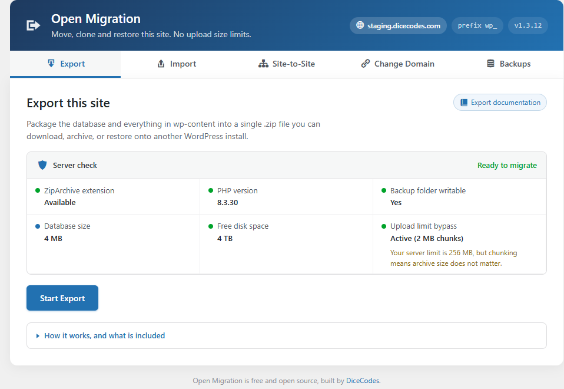
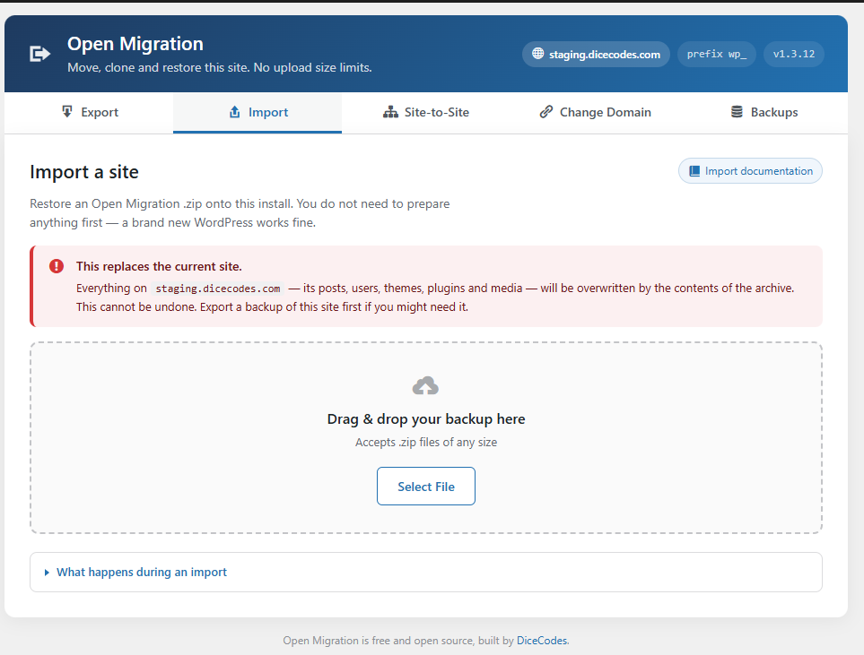
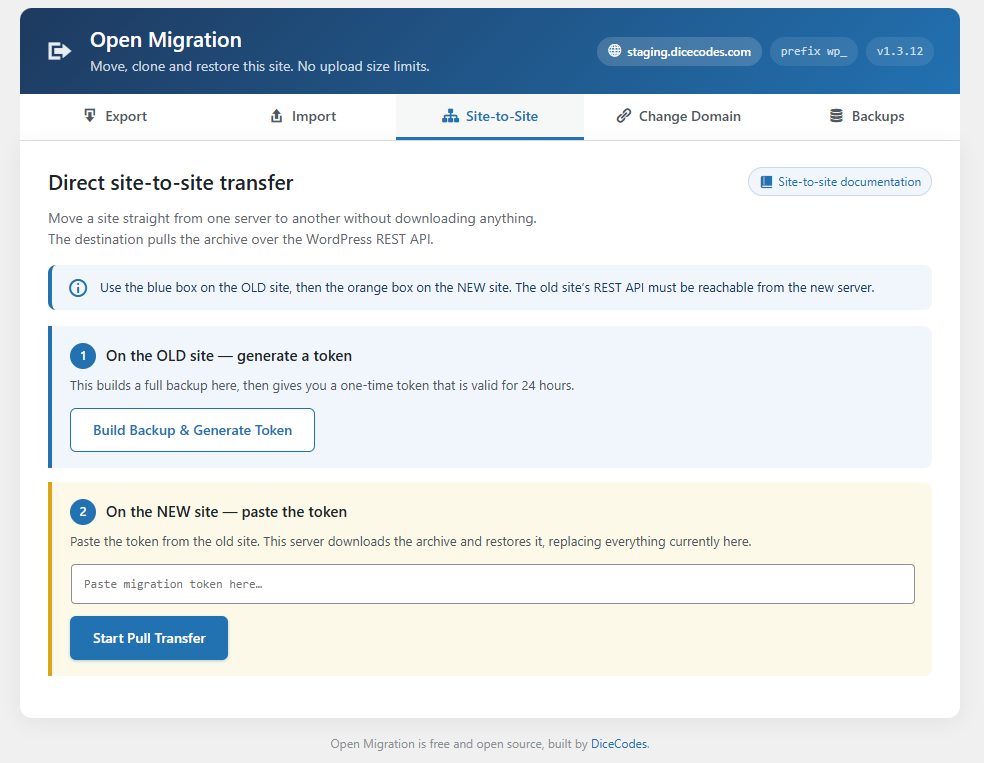
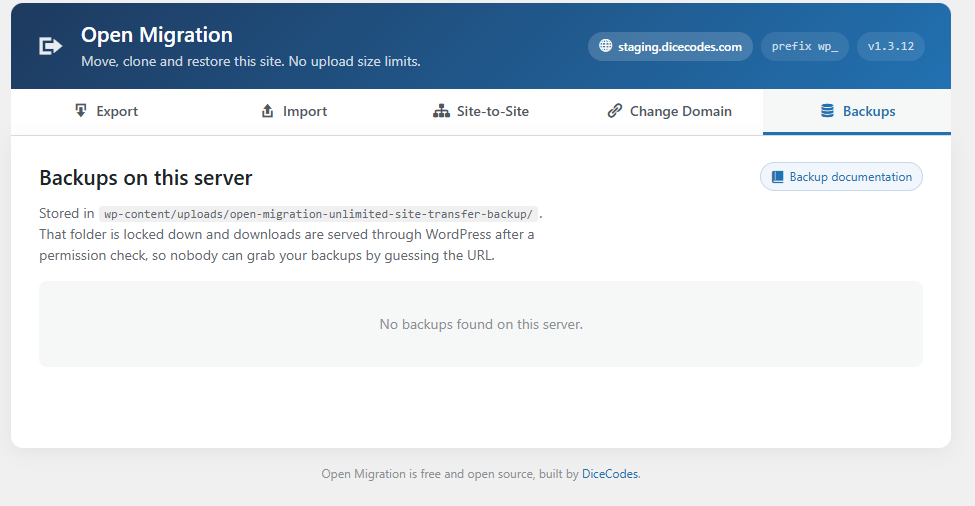

# Open WP Migration — Free WordPress Migration Plugin with No Size Limit

### Migrate, clone and back up any WordPress site for free — a genuinely unlimited alternative to paid migration plugins.

**Move a WordPress site to a new host, clone it to staging, or restore a full backup — with no upload size limit, no premium extension and no account.**

Import a 5GB+ site on shared hosting. Site URLs, server paths and even a different database table prefix are converted automatically, including inside serialised data that a plain find-and-replace would corrupt.

Your data never leaves your server. No cloud dependency, no tracking, no paid tier. Open source under GPLv2.

**Looking for:** a free All-in-One WP Migration alternative · a way to import a large WordPress backup without buying an extension · a Duplicator or UpdraftPlus alternative that does search-replace for free · a plugin to move WordPress from staging to live without breaking serialised data? That is what this is.

[Install from WordPress.org](https://wordpress.org/plugins/open-migration-unlimited-site-transfer-backup/) &nbsp;|&nbsp; [Documentation](https://dicecodes.com/open-migration/) &nbsp;|&nbsp; [Download Now](https://github.com/IamRamgarhia/Open-WP-Migration/releases/latest) &nbsp;|&nbsp; [Screenshots](#screenshots) &nbsp;|&nbsp; [5-Minute Quick Start](#your-first-backup-in-5-minutes) &nbsp;|&nbsp; [Report Bug](https://github.com/IamRamgarhia/Open-WP-Migration/issues) &nbsp;|&nbsp; [Request Feature](https://github.com/IamRamgarhia/Open-WP-Migration/issues)

---

## 📸 Screenshots

<table align="center">
  <tr>
    <td align="center">
      <b>Seamless Site Export</b>  
      
       <i>One-click exports with intelligent chunking.</i>
    </td>
    <td align="center">
      <b>Limitless Site Import</b>  
      
       <i>Bypass PHP upload limits completely.</i>
    </td>
  </tr>
  <tr>
    <td align="center">
       <b>Direct Site-to-Site Transfer</b>  
      
       <i>Pull your site directly without a ZIP file.</i>
    </td>
    <td align="center">
       <b>Built-in Backup Management</b>  
      
       <i>Manage, download, or delete past backups.</i>
    </td>
  </tr>
</table>

---

## 📑 Table of Contents

- [Why Choose Open Migration?](#why-choose-open-migration)
- [Your First Backup in 5 Minutes](#your-first-backup-in-5-minutes) — *start here if you're new*
- [Key Features](#key-features)
  - [Migration & Export](#outbox_tray-migration--export)
  - [Import & Restoration](#inbox_tray-import--restoration)
  - [Backup Management](#briefcase-backup-management)
- [Comparison with other WordPress migration plugins](#-comparison-with-other-wordpress-migration-plugins)
- [Quick Start / Installation](#quick-start--installation)
- [Documentation & FAQ](#books-documentation--faq)
- [Who Is This For?](#who-is-this-for)
- [Why Is This Free?](#why-is-this-free)
- [Data Privacy & Security](#data-privacy--security)
- [Contributing](#contributing)
- [Contact & Support](#contact--support)

---

## Your First Backup in 5 Minutes

A step-by-step guide for creating your very first full-site backup. Targeted at users who want to safely export their site before making changes.

### Before you start
You need: A WordPress website running PHP 7.2 or higher with the ZipArchive extension enabled. The Export tab runs a server check and tells you if anything is missing. **No coding knowledge required.**

### Step 1 — Install (1 minute)

**From your WordPress dashboard (recommended):**

1. Go to **Plugins → Add New**.
2. Search for **Open Migration Unlimited Site Transfer** — search the full name; "open migration" alone returns the bigger migration plugins first. Or go straight to the [plugin page](https://wordpress.org/plugins/open-migration-unlimited-site-transfer-backup/).
3. Click **Install Now**, then **Activate**.

You will get automatic updates this way.

**Or install manually:**

1. Download the latest release from [WordPress.org](https://wordpress.org/plugins/open-migration-unlimited-site-transfer-backup/) or the [Releases page](https://github.com/IamRamgarhia/Open-WP-Migration/releases/latest).
2. Go to **Plugins → Add New → Upload Plugin** and choose the `.zip`.
3. Click **Install Now**, then **Activate**.

Install it on **both** sites — the one you are moving from and the one you are moving to.

### Step 2 — Create your export (2 minutes)

1. Click on **Open Migration** in your WordPress sidebar.
2. You will land on the **Export** tab.
3. Check the **Server check** panel at the top — it confirms ZipArchive is available, the backup folder is writable, and you have enough disk space.
4. Review the "Included / Not included" lists so you know exactly what is being packaged.
5. Click **Start Export**.
6. Watch the progress bar as it packages your site into a `.zip`, one batch at a time.

### Step 3 — Download or Manage (1 minute)

Once the export finishes, you have two options:
- **Download immediately:** Click the download prompt to save the ZIP to your computer.
- **Manage Backups:** Switch to the **Backups** tab to see all your past exports. From here, you can download them or delete them to free up server space.

That's it! You have successfully backed up your WordPress site. 

📖 **Full walkthrough** — see the [Documentation & FAQ](#books-documentation--faq) below for importing instructions.

---

## Why Choose Open Migration?

Most WordPress migration plugins — All-in-One WP Migration, Duplicator, UpdraftPlus — charge you for premium extensions the moment your website gets larger than 512MB, or if you want to use Multisite. **Open Migration is the open-source alternative that changes everything.**

- **Completely free** — no premium tier, no paid extensions, no hidden charges.
- **ZERO file size limits** — whether your site is 50MB or 50GB, we migrate it for free.
- **Your data stays on YOUR server** — backups are stored in `wp-content/uploads/owpm-backups`. No cloud tracking.
- **Restores onto a fresh WordPress** — site URL, server paths and even a different table prefix are converted for you.
- **Lightweight, native UI** — plain JavaScript, no build step, no framework payload.
- **Install once, use forever** — GPLv2 licensed, open-source, community-driven.

> **If you're paying to move your own data, you can stop now.**

### 📊 Comparison with other WordPress migration plugins

All three alternatives are good plugins. This table is about **where the free tier ends**, because that is the difference that matters when your site outgrows it.

| Feature | **Open Migration** | All-in-One WP Migration | Duplicator | UpdraftPlus |
|---|---|---|---|---|
| **Licence** | ✅ GPLv2, fully open source | Freemium | Freemium | Freemium |
| **Import size limit, free tier** | ✅ **No limit** | 512 MB[1] | No stated cap; Pro advised for large sites[2] | Bounded by host limits |
| **Removing the size limit** | ✅ Included | Paid extension (~$69/yr)[1] | Pro | Paid |
| **URL search & replace** | ✅ Automatic | ✅ Included | ✅ Included | ⚠ Migrator addon (paid) |
| **Table prefix conversion** | ✅ Automatic | ✅ Included | ✅ Included | ⚠ Migrator addon (paid) |
| **Serialisation-safe replacement** | ✅ Yes | ✅ Yes | ✅ Yes | ✅ Yes |
| **Direct site-to-site transfer** | ✅ Included | ⚠ Paid extension | ⚠ Pro | ⚠ Paid |
| **Change domain after a DNS switch, with a DNS pre-flight check** | ✅ Included | ➖ Manual | ➖ Manual | ➖ Manual |
| **Scheduled automatic backups** | ➖ Not offered | ⚠ Paid | ⚠ Pro[2] | ✅ **Included free** |
| **Cloud storage (Drive, Dropbox, S3)** | ➖ Not offered | ⚠ Paid extension | ⚠ Pro[2] | ✅ **Included free** |
| **Multisite network migration** | ➖ Not supported | ⚠ Paid extension | ⚠ Pro[2] | ⚠ Paid |
| **Account or sign-up required** | ✅ Never | ✅ No | ✅ No | ✅ No |
| **Your data stays on your server** | ✅ Yes | ✅ Yes | ✅ Yes | ✅ Yes |

**Where the others are the better choice:** if you want scheduled backups to Dropbox or Google Drive, UpdraftPlus does that for free and Open Migration does not do it at all. If you need multisite, none of the free tiers here will help you. Open Migration is built for one job — moving or restoring a single site of any size, without paying for it.

[1] All-in-One WP Migration free import cap and Unlimited Extension pricing, per third-party reporting. [2] Duplicator Lite excludes scheduled backups, cloud storage and multisite; those are Pro features. Verified August 2026 — vendors change their tiers, so check before relying on it.

---

## Key Features

### :outbox_tray: Migration & Export
- **One-Click Export:** Package your Database, Themes, Plugins, Uploads, and Metadata into a single standard `.zip` file.
- **Real-Time Tracking:** Watch exactly which file is being zipped with our real-time UI tracking so you never wonder if the process stalled.
- **Resumable Batches:** The database dump and file archive run in small batches sized to your server, so exports never time out.
- **Selective Exporting (Coming soon):** Choose to exclude media files, spam comments, or specific plugins.

### :inbox_tray: Import & Restoration
- **Bypass PHP Upload Limits:** Built-in chunking allows you to upload massive files even if your web host restricts `upload_max_filesize`.
- **Automatic Search & Replace:** Finds your old domain and replaces it everywhere — including inside PHP-serialised values (length prefixes are recalculated, so nothing breaks), JSON-escaped block markup, URL-encoded links and protocol-relative references.
- **Table Prefix Conversion:** Importing a `wp_oldsite_` database into an install that uses `wp_`? Tables, option names and user meta keys are all converted during the restore.
- **Resumable Restore:** Extraction, the SQL import and the URL rewrite all run in short batches that pick up where they left off, so large sites cannot time out.

### :briefcase: Backup Management
- **Centralized Dashboard:** View all your past `.zip` exports directly within WordPress.
- **One-Click Download/Delete:** Easily manage server space by deleting old backups or downloading them to your local hard drive.

---

## 📚 Documentation & FAQ

**Q: Is it really 100% free? Are there any hidden fees?**  
**A:** Yes. Open Migration is 100% free and open-source forever. There are no "Pro" versions, no paid extensions, and no hidden subscriptions.

**Q: What is the maximum file size I can import?**  
**A:** Unlimited. Unlike All-in-One WP Migration which caps free imports at 512MB, Open Migration utilizes chunked uploading to bypass server limits, allowing you to migrate 5GB+ sites easily.

**Q: How does this compare to Duplicator or UpdraftPlus?**  
**A:** Duplicator requires you to manage `installer.php` files and manually create databases. UpdraftPlus charges for basic features like database search and replace. Open Migration is a single-click solution inside WordPress that handles the database replacement automatically for free.

**Q: Where are my backups stored, and can anyone else download them?**  
**A:** In `wp-content/uploads/owpm-backups`. The folder gets deny-all rules for Apache 2.2, Apache 2.4 and IIS plus an index file, and archive names include 32 random characters. Most importantly, downloads are streamed through WordPress only after a capability and nonce check, so the folder never has to be publicly readable — which is what keeps backups safe on Nginx, where `.htaccess` files are ignored entirely.

**Q: Why am I logged out after importing?**  
**A:** The archive brings its own user accounts, which replace the ones on the destination — that invalidates your session. Log back in with the username and password from the **original** site. If your account exists on both with administrator rights, the plugin signs you back in automatically.

**Q: Does this work on WordPress Multisite?**  
**A:** Not yet, but Multisite support is our top priority for the next major release—and it will be 100% free when it launches!

---

## Who Is This For?

- **Freelancers & Agencies:** Stop paying $69/year for basic migration extensions every time you move a client site from staging to production.
- **DIY Website Owners:** Safely backup your site before updating plugins or changing themes without needing a degree in server administration.
- **Developers:** An open-source tool you can fork, modify, and contribute to.

## Why Is This Free?

Because your data belongs to you. The WordPress ecosystem was built on the back of free, open-source software (GPL). We believe that moving your own website from one host to another is a fundamental right, not a premium feature to be locked behind a paywall.

## Data Privacy & Security

**Privacy:** Open Migration is strictly offline-first. Your data is compressed locally on your server. We do not track you, we do not require you to create an account, and we absolutely do not send your website data to our servers.

**Security:** The backup directory is protected with deny-all rules for Apache and IIS plus index files to prevent directory browsing, and every backup download is served through WordPress behind a capability and nonce check rather than as a directly reachable file. Imported archives are validated entry by entry before extraction, so a malicious `.zip` cannot write outside `wp-content`. Every admin action requires the `manage_options` capability and a valid nonce.

**Note on site-to-site transfers:** this is the only feature that makes an outbound connection, and only to the address contained in the token you paste. Nothing is ever sent to the plugin author.

---

## Contributing

We strongly believe in community-driven development! If you want to help make Open Migration even better:
1. Fork the repository.
2. Create a new branch (`git checkout -b feature/AmazingFeature`).
3. Commit your changes (`git commit -m 'Add some AmazingFeature'`).
4. Push to the branch (`git push origin feature/AmazingFeature`).
5. Open a Pull Request.

## Contact & Support

If you found a bug or have a feature request, please [open an issue on GitHub](https://github.com/IamRamgarhia/Open-WP-Migration/issues), or ask on the [WordPress.org support forum](https://wordpress.org/support/plugin/open-migration-unlimited-site-transfer-backup/).

If the plugin saved you a migration, a [review on WordPress.org](https://wordpress.org/support/plugin/open-migration-unlimited-site-transfer-backup/reviews/) genuinely helps other people find it.

*Made with ❤️ for the WordPress Community.*
